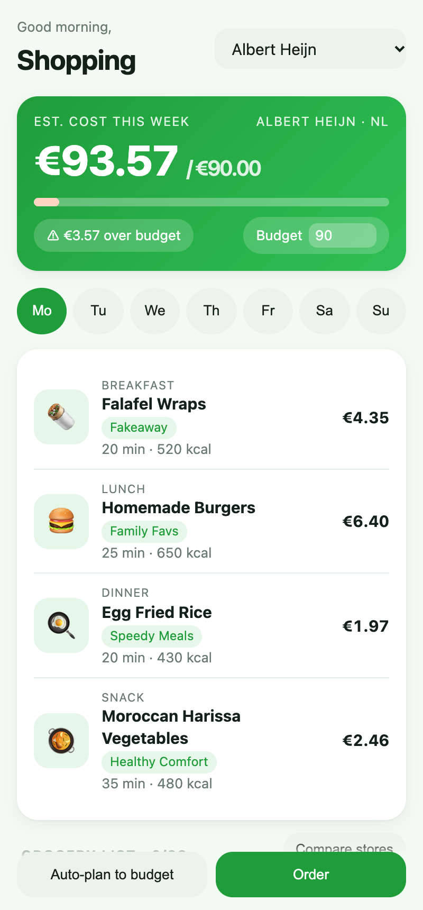
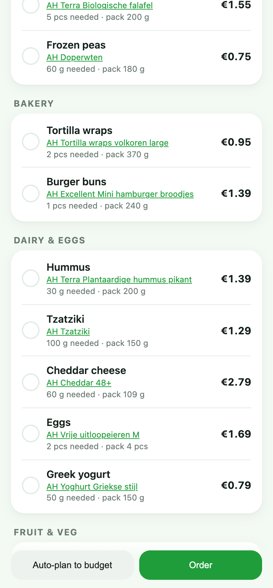
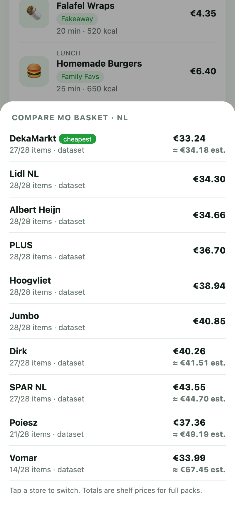
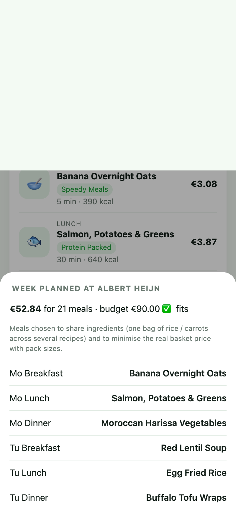
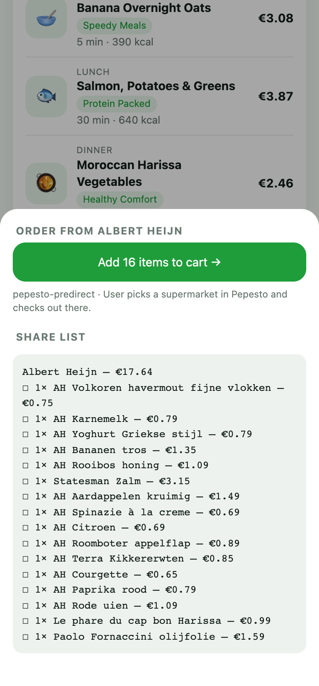
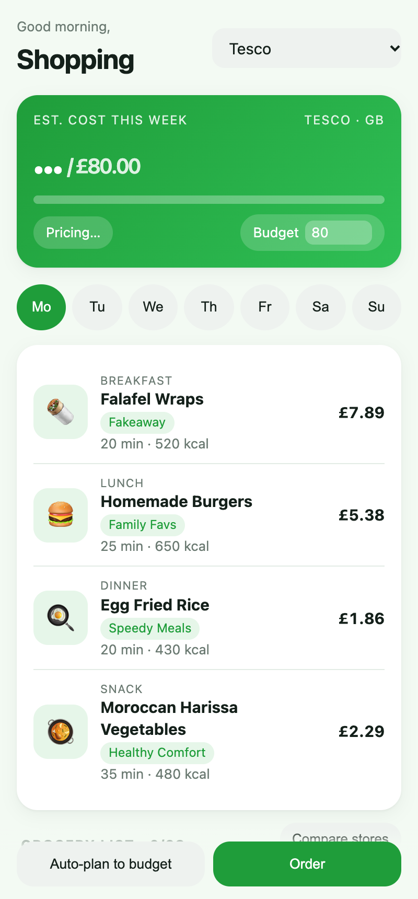
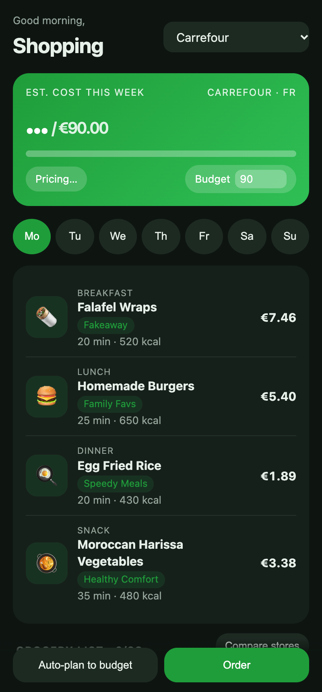

# 🛒 grocery-engine

**Реальные цены продуктовых магазинов Европы, Украины и Казахстана для вкладки Shopping в приложении планирования питания.**

Блюда выбранного дня → список продуктов → цены в выбранном магазине → подбор блюд под бюджет → корзина или заказ.

`68 магазинов` · `28 стран` · `21 язык` · `Node 24 + TypeScript` · `0 runtime-зависимостей` · `11 тестов`

> **Передаёте или принимаете проект?** Начните с [HANDOFF.md](HANDOFF.md): там запуск, архитектура, известные проблемы и открытые решения.

## Скриншоты

Демо вкладки (`web/index.html`), все цены настоящие, сняты 08.11.2026.

| Вкладка Shopping | Список продуктов | Сравнение магазинов | План под бюджет |
|---|---|---|---|
|  |  |  |  |
| Блюда дня с ценой, бюджет недели | Товар, фасовка, нужное количество, цена | Одна корзина во всех сетях страны | 21 блюдо, общие упаковки между блюдами |

| Заказ (Pepesto) | Казахстан (Wolt) | Великобритания (Tesco) | Тёмная тема (Carrefour FR) |
|---|---|---|---|
|  |  |  |  |
| «Add 16 items to cart» и текст списка | Small, Алматы, цены в тенге | Цены сетей Великобритании через trolley.co.uk | Цены по чекам (Open Prices) |

## Возможности

- **Список продуктов на день:** ингредиенты всех блюд дня объединяются (1 морковь + 140 г моркови = 3 шт.).
- **Подбор товара в магазине:** перевод на язык магазина, пересчёт в упаковки (2 моркови → пакет 1 кг), отсев ложных совпадений («Zitronen**radler**» не лимон).
- **Сравнение магазинов:** одна корзина во всех сетях страны, дешёвые сверху.
- **План под бюджет:** блюда подбираются так, чтобы делить упаковки; итог считается честно, по полкам.
- **Заказ:** Instacart (США и Канада), Pepesto (Европа, бесплатный режим проверен вживую), ссылки на товары (Wolt и др.), текст для «Поделиться».

## Быстрый старт

```bash
npm install               # только dev-зависимости (typescript, @types/node)
npm start                 # API и демо на http://localhost:8787
npm test                  # 11 офлайн-тестов
npm run typecheck
npm run smoke -- ah-nl tesco-gb       # живая корзина «понедельника» в выбранных магазинах
node scripts/coverage.ts              # живой прогон по всем магазинам -> data/COVERAGE.md
```

**Для мобильного приложения:** из [`openapi.yaml`](openapi.yaml) генерируется клиент для Swift, Kotlin или Flutter; [`client/shopping-client.ts`](client/shopping-client.ts) — готовый клиент для React Native и веба.

```ts
const api = new ShoppingClient('https://your-host');
const basket = await api.quote('ah-nl', mondayMeals);        // цены и упаковки
const order  = await api.cart('ah-nl', { quote: basket });   // order.url -> открыть
```

## Что покрыто (проверено живыми запросами 08.11.2026; актуальная таблица — [data/COVERAGE.md](data/COVERAGE.md))

**68 магазинов в 28 странах** плюс любой продуктовый магазин Wolt (~25 стран) и Instacart для США и Канады.

| Страна | Магазины | Источник | Корзина пн (28 шт.) |
|---|---|---|---|
| 🇬🇧 GB | Tesco, Sainsbury's, Waitrose, Morrisons, Asda, Iceland, Co-op | trolley.co.uk (ежедневные цены сетей) | Tesco 28, Sainsbury's 27, Waitrose 22 |
| 🇳🇱 NL | Albert Heijn, Jumbo, Lidl, PLUS, Dirk, Hoogvliet, SPAR, DekaMarkt, Poiesz, Vomar | датасет checkjebon.nl, обновляется ежедневно | AH, Jumbo, Lidl, PLUS, Hoogvliet — 28 |
| 🇩🇪 DE | REWE (цены маркета по индексу) | live API | 27 |
| 🇪🇸 ES | Mercadona (склад через `branchId`) | live, Algolia | 26 |
| 🇵🇹 PT | Continente | live, HTML | 28 |
| 🇵🇱 PL | Frisco | live API | 28 |
| 🇫🇮 FI | Prisma / S-kaupat (S Group, ~46% рынка) | live GraphQL | 27 |
| 🇪🇪 🇱🇻 🇱🇹 | Rimi EE / LV / LT | live, HTML | 24 / 26 / 27 |
| 🇭🇷 HR | Konzum | live, HTML | 26 |
| 🇦🇹 AT | BILLA | датасет heisse-preise.io | 26 |
| 🇺🇦 UA | Сільпо (463 филиала) | live API | 27 |
| 🇰🇿 KZ | Small/Eurospar, galmart, Airba, Wolt Market (Алматы) | live, Wolt | 19–25 |
| 🇫🇷 FR | E.Leclerc, Carrefour, Auchan, Intermarché, Super U, Monoprix, Franprix, Lidl, Aldi | Open Prices (крауд-цены по чекам, ODbL; ежедневная выгрузка, дата наблюдения у каждой цены) | Leclerc, Carrefour, Intermarché, Super U — 28 |
| 🇳🇴 🇸🇪 🇩🇪 | Extra, Kiwi, Rema 1000, Willys, EDEKA | Open Prices | 21–24 |
| Kaufland DE / CZ / SK | акции недели (онлайн-магазин закрыт антиботом, страница акций открыта) | live, HTML | 14 / 16 / 17 |
| Lidl ×18 | IT, PT, BG, RO, CH, AT, HU, SI, RS, HR, LT, LV, EE, SE, DK, FI, GB, IE | live API Lidl | 2–16: онлайн у Lidl только акции и часть ассортимента, источник для «скидок недели» |
| ~25 стран | любой продуктовый магазин Wolt рядом с пользователем (`/api/wolt/venues`) | live | — |
| 🇺🇸 🇨🇦 | все магазины Instacart | Instacart Developer Platform | готовая корзина |

Не находится в основном то, чего в магазине реально нет: фалафель, хумус, харисса.

### Проверено и не работает с обычного IP (Akamai / Cloudflare / закрытый API)
- **Великобритания напрямую:** Tesco, Sainsbury's, Asda, Aldi, Iceland, Co-op. Цены этих сетей идут через trolley.
- **Остальная Европа:** Ocado, M&S, Carrefour FR/ES/IT/PL, Leclerc, Auchan FR (цена скрыта до выбора магазина), Dia, Eroski, Consum, интернет-магазин Kaufland (акции подключены), Netto, Aldi Süd, Delhaize, Colruyt (нужен ключ приложения), Migros, Coop CH, Esselunga, Conad, Rohlik/Knuspr/Kifli, Tesco CZ/HU, Billa CZ, Barbora, Selver, Iki, Spar HU, mymarket/Sklavenitis GR.
- **Украина и Казахстан:** Zakaz.ua (Novus/Auchan/Metro/Eko UA), Auchan UA, Arbuz.kz.

Как закрыть: резидентные прокси (~$3–8/GB) **или** платный Pepesto (`/catalog` / `/products`; покрывает Ocado, Colruyt, Delhaize, Migros, Coop CH, Esselunga, Conad, ICA, nemlig и др.). Для Zakaz.ua и Glovo (Magnum KZ, Varus и Novus UA) нужен прокси или реверс мобильного API.

## Аналог Instacart для Европы: Pepesto
- `POST https://s.pepesto.com/api/predirect` — **бесплатный и публичный**, без ключа. Принимает список (до 30 строк) и отдаёт ссылку, по которой юзер выбирает супермаркет, а Pepesto собирает реальную корзину. Проверено: `Pepesto-Eurocents-Charged: 0`.
- `/products` (0.04–0.32 €) + `/mcheckout` (0.60 €) — корзина в конкретной сети: Tesco, Sainsbury's, Asda, Waitrose, Ocado, AH, Jumbo, Plus, Colruyt, Delhaize, Migros, Coop CH, REWE, Esselunga, Conad, Frisco, Auchan PL, eBag, ICA, nemlig, Meny, Continente. Нужен `PEPESTO_API_KEY` (оплата кредитами через Stripe).
- `/catalog` (9.60 € за полный каталог сети в день) — альтернатива парсерам для заблокированных UK/CH/IT. Дешевле прокси, если сетей немного.

Другие найденные варианты: MealCP (EU price API, бета закрыта), Open Food Facts **Open Prices** (крауд-цены по лицензии ODbL, полезно для офлайн-дискаунтеров Lidl/Aldi/Biedronka; ~150k цен), Apify-акторы (оплата за прогон).

## API (для мобильного приложения)

| Метод | Тело | Что возвращает |
|---|---|---|
| `GET /api/stores?country=NL` | — | магазины страны |
| `GET /api/wolt/venues?lat=&lon=` | — | продуктовые магазины Wolt рядом |
| `POST /api/wolt/register` | venue из ответа выше | id магазина `wolt-<slug>` |
| `POST /api/list` | `{meals}` | агрегированный список продуктов на день |
| `POST /api/quote` | `{storeId, meals \| ingredients, ctx?}` | корзина: товар, фасовка, кол-во упаковок, цена, альтернативы |
| `POST /api/compare` | `{country \| storeIds, meals}` | магазины по возрастанию суммы (с учётом ненайденного) |
| `POST /api/plan` | `{storeId, meals, slots, budget, people?, moods?, excludePantry?}` | блюда по слотам под бюджет + корзина |
| `POST /api/cart` | `{storeId, quote \| meals, provider?}` | ссылка на заказ / ссылки на товары / текст для «Поделиться» |

`ctx`: `{postalCode}` для REWE, `{branchId}` для Mercadona-склада или филиала Сільпо.
Деньги везде в минорных единицах (центы, копейки, тиыны).

## Как устроено

```
meals of the day ─► aggregate() ─► ingredients (canonical EN, qty in g/ml/pcs)
                                        │
                     lexicon: EN → de/nl/es/pl/uk/ru/et (+ exclude-слова, вес штуки, fallback)
                                        │
             connector.search(term) ─► offers (цена, фасовка) ─► relevance() ─► cheapest in top tier
                                        │                            (packsNeeded: 2 моркови из пакета 1 кг)
                               BasketQuote ─► compare / plan (общие упаковки между блюдами) ─► cart handoff
```

- `src/connectors/live.ts` — Mercadona, REWE, Frisco, Сільпо, Wolt (+ discovery).
- `src/connectors/more.ts` — Lidl (18 стран), Rimi (EE/LV/LT), Continente, Prisma (FI), Konzum, trolley (сети UK). HTML-запросы склеиваются, кэшируются, не больше 4 одновременных на хост, есть повторы.
- `src/connectors/openprices.ts` — Open Prices: сети, недоступные напрямую. Цена — оценка по последнему чеку, в `observedAt` лежит дата наблюдения. **Качество подбора ниже, чем у живых магазинов:** в базе мало свежих овощей и фруктов, поэтому иногда выбирается переработанный продукт (лимон → печенье с лимоном). Особенно это заметно в NO, SE и DE.
- `src/lexicon-extra.ts` — словарь на pt, it, fi, sv, da, lt, lv, hr, sl, sr, bg, ro, hu, cs, sk.
- `src/connectors/datasets.ts` — checkjebon (NL), heisse-preise (AT): скачиваются раз в сутки в `.cache/`, при сбое используется устаревший кэш.
- `src/matcher.ts` — релевантность:
  - составные слова: Kirsch**tomaten** подходит, **Zitronen**radler нет;
  - ингредиент после предлога не считается («Mantecado *de* limón»);
  - отсекаются непищевые товары и цены ≤ 0.10;
  - если товара нет, берётся fallback (red onion → onion).
- `src/planner.ts` — жадный подбор и улучшение обменами. Стоимость считается честно, с округлением до упаковок: 4 блюда с рисом покупают 1 пакет риса.
- `src/cart.ts` — провайдер подбирается по стране: Instacart (US/CA), Pepesto (EU-13), ссылки на товары (Wolt и др.), текст.
- `web/index.html` — демо вкладки: дни, блюда с ценой, список по категориям, сравнение магазинов, «Auto-plan to budget», «Order».

## Что дальше
1. **Расширить словарь** (`src/ingredients.ts` + `src/lexicon-extra.ts`: ~75 ингредиентов × 20 языков). Для неизвестных ингредиентов подключить хук `translate` в `matchIngredient` (LLM или переводчик) и кэшировать ответы.
2. **Кэш цен в БД.** Сейчас кэш в памяти на 6 часов. Нужен Postgres или Redis и ночной прогон популярных ингредиентов по всем магазинам, тогда ответ приходит мгновенно и магазины не получают лишнюю нагрузку.
3. **CH/IT/BE/FR полной полкой:** ключ Pepesto (`/catalog` или `/products`) или прокси-коннекторы. Великобритания уже покрыта через trolley.
4. **Украина, расширение:** коннектор Zakaz.ua (Novus, Auchan, Metro, Varus, Megamarket; нужен прокси) и АТБ. **Казахстан:** Arbuz.kz (нужен токен приложения), Magnum через Glovo.
5. **Слоты приёма пищи** в планировщике (теги breakfast/lunch), аллергены и диеты как фильтр блюд.
6. **Ключи для платных частей:** `INSTACART_API_KEY` (заявка в Instacart Developer Platform) и `PEPESTO_API_KEY`. Формат запросов сверен с документацией и закрыт контрактными тестами, но живой вызов без ключей не проверить.
7. **Юридически:** неофициальные API могут измениться или закрыться. Обращаться к ним бережно (кэш, ограничение частоты), а для продакшена в EU по возможности перейти на партнёрки (Pepesto, affiliate-программы Wolt и сетей).
